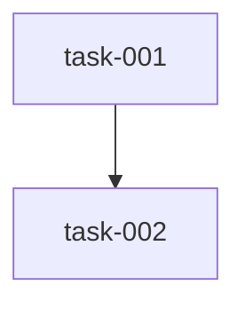

# Plan formats

The `.plans/` structure shared by `create-plan`, `init-task`, `implement-task` and `implement-epic`.

```text
.plans/<feature-name>/        # kebab-case
├── EPIC.md
├── STATUS.md
└── tasks/
    └── task-NNN-<slug>.md
```

## EPIC.md

```markdown
# <Feature name>

- **Status**: planned | in_progress | completed
- **Priority**: high | medium | low
- **PRD**: ../../PRD.md

## Summary
3 to 5 sentences: problem, solution, impact.

## Success metrics
| Metric | Baseline | Target | Timeline |

## Scope
- **Must**: ...
- **Should (post-MVP)**: ...
- **Won't (out of scope)**: ...

## Dependencies and risks
| Risk | Impact | Mitigation |
```

## STATUS.md

```markdown
# Status: <Feature name>

**Last updated**: YYYY-MM-DD

| Status | Tasks | Story points |
|---|---|---|
| completed / in_progress / pending / blocked / needs_attention | N | N |

## Tasks
- [ ] **task-001** <title> (3 SP) `pending` [agent]

## Dependencies


## Next steps
Tasks without open blockers.
```

## Task file

```markdown
# Task-NNN: <title>

## Metadata
- **ID**: task-NNN
- **Status**: pending | in_progress | completed | blocked | needs_attention
- **Priority**: must | should | could
- **Type**: feature | bug | documentation | refactor | testing
- **Estimate**: 1 | 2 | 3 | 5 | 8 Story Points
- **Assignee**: <recommended agent or none>
- **Created** / **Updated**: YYYY-MM-DD
- **Plan**: <feature-name> | standalone

## Description
What and why. User story: As a <persona>, I want <action> so that <benefit>.

## Acceptance criteria
- [ ] testable criterion

## Definition of Done
- [ ] All acceptance criteria verified
- [ ] Code reviewed
- [ ] Tests written and passing
- [ ] Documentation updated (if applicable)
- [ ] <task-specific items>

## Dependencies
- **Requires**: task-XXX | none
- **Blocks**: task-YYY | none
```

## Type to branch and commit prefix

| Type | Branch | Commit type |
|---|---|---|
| feature | `feature/` | `feat` |
| bug | `bugfix/` | `fix` |
| documentation | `docs/` | `docs` |
| refactor | `refactor/` | `refactor` |
| testing | `test/` | `test` |

Branch name: `<prefix><task-id>-<slug>`, for example `feature/task-001-ui-toggle`.
